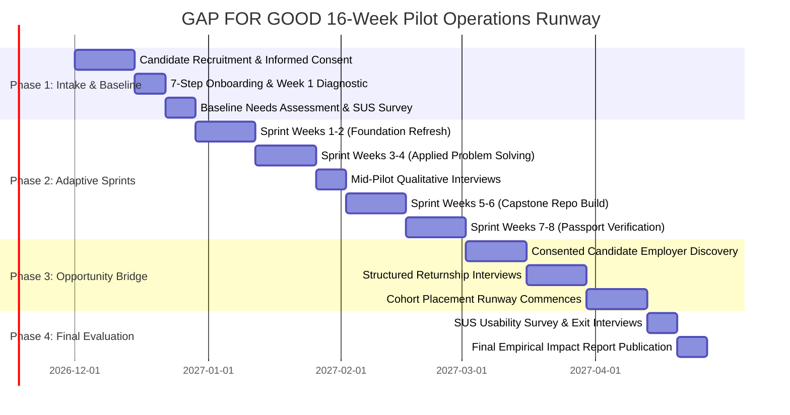

# GAP FOR GOOD (GFG 2.0) — Pilot Validation & Empirical Research Plan

**Document Classification:** Pilot Research Protocol, Operational Plan & Ethics Charter  
**Cohort Target:** 20–30 Consenting Returning Women | 3–5 Prospective Employer Partners (Recruitment Goals)  
**Execution Runway:** 16-Week Empirical Evaluation Protocol  
**Version:** 2.0.0-PROD-CANDIDATE  
**Date:** November 2026  

---

## 1. Executive Summary & Research Objectives

The purpose of the GAP FOR GOOD (GFG 2.0) Pilot Study is to empirically evaluate the feasibility, usability, psychological impact, and placement efficacy of an integrated skills-first return-to-work platform.

While the underlying software platform has achieved complete architectural stability with 212 automated tests passing, real-world workforce re-entry involves complex human, psychological, and market dynamics that cannot be simulated through software tests alone.

### Primary Research Objectives
1. **Usability & Engagement:** Measure whether returning women with varying hiatus lengths can seamlessly navigate the 7-step onboarding assessment, adaptive 8-week curriculum, and Career Passport tools.
2. **Psychological Impact:** Test the hypothesis that structured daily micro-actions, cognitive reframing, and Comeback Circles produce statistically significant increases in self-reported career confidence.
3. **Technical Currency Recovery:** Quantify delta gains between Week 1 diagnostic baselines and Week 8 post-sprint capstone evaluations.
4. **Employer Opportunity Bridge Efficacy:** Evaluate whether verified, skills-first Career Passports successfully bypass automated ATS filters and result in structured returnship fellowship placements with 0% career gap penalties.

> [!IMPORTANT]
> **Pre-Registration & Non-Fabrication Principle:**
> All participant numbers, employer counts, completion rates, and placement benchmarks in this document are **pre-registered scientific hypotheses and operational targets**. GAP FOR GOOD explicitly rejects presenting prospective targets as historical outcomes. No participants or employers will be reported until consented, live cohort operations commence.

---

## 2. Participant Recruitment, Screening & Eligibility

To ensure actionable research outcomes while protecting candidate welfare, the pilot establishes rigorous eligibility criteria:

### 2.1 Candidate Cohort Profile (Target: 20–30 Women)
- **Career Hiatus Criteria:** Minimum continuous career break of 12 months for caregiving, maternity, family health, or personal sabbatical.
- **Prior Experience:** Minimum 2 years of pre-break professional tenure in software engineering, cloud infrastructure, data analytics, product management, or digital systems.
- **Time Commitment:** Ability to commit 10–15 hours per week over 8 weeks to self-paced learning, hands-on capstone development, and weekly mentor syncs.
- **Technical Prerequisites:** Access to a desktop/laptop computer and broadband internet connectivity (subsidized data dongles provided where needed).

### 2.2 Employer Partner Profile (Target: 3–5 Organizations)
- **Corporate Profile:** Mid-to-large technology companies, enterprise capability centers, or VC-backed growth startups with active engineering vacancies.
- **Charter Commitment:** Mandatory executive signing of the GFG Non-Discriminatory and Caregiving-Dignity Charter.
- **Returnship Capacity:** Willingness to pilot at least one paid 12–16 week structured returnship track with an assigned 1:1 engineering mentor and guaranteed living stipend.

---

## 3. Informed Consent & Ethical Protections

Candidate participation is governed by institutional human-research ethics standards:

1. **Voluntary Informed Consent:** Candidates receive a clear, plain-language consent briefing detailing what data is logged (diagnostic scores, check-in ratings, time-on-platform), how it is analyzed, and who can view it.
2. **Decoupled Learning Access:** A candidate's decision not to participate in the research study does not restrict her access to the educational materials or platform tools.
3. **Unconditional Right of Withdrawal:** Candidates can withdraw from the pilot at any point with zero financial, academic, or professional penalty. Upon withdrawal, candidates can request the permanent purge of their records.
4. **Anonymized Research Datasets:** All published research findings and pilot reports will be scrubbed of personally identifiable information (PII) using \(k\)-anonymity standards (\(n \ge 5\) suppression).

---

## 4. Sixteen-Week Pilot Timeline & Operational Runway



---

## 5. Quantitative Measurement Instruments & Target Thresholds

To prevent confirmation bias, success thresholds are pre-registered prior to cohort kickoff:

| Evaluation Dimension | Measurement Instrument | Success Threshold (Hypothesis) | Failure / Pivot Trigger |
|---|---|---|---|
| **Platform Usability** | Standardized System Usability Scale (SUS) (10 questions, 1–5 Likert) | Mean SUS Score \(\ge 80\) (Grade A Usability) | Mean SUS Score \(< 68\) (Below average) |
| **Curriculum Completion** | Database `learning_progress` records | \(\ge 75\%\) of enrolled participants complete all 8 roadmap sprints | \(< 50\%\) completion rate |
| **Confidence Gains** | Daily confidence pulse slider (1–5 scale, `confidence_check_ins`) | Statistically significant positive delta (\(\ge +1.5\) points, \(p < 0.05\)) | No statistically significant gain (\(p \ge 0.05\)) |
| **Evidence Completion** | Verified public GitHub repository with unit tests | \(\ge 80\%\) of completers publish a verified capstone project | \(< 50\%\) capstone completion |
| **Interview Conversion** | Application pipeline progression (`applications.status`) | \(\ge 25\%\) of candidates who apply secure structured returnship screens | \(< 10\%\) interview conversion rate |
| **Employer Charter Compliance** | Recruiter audit logs & feedback surveys | 100% of participating employers enforce zero salary history inquiries | Single reported breach of Caregiving Charter |

---

## 6. Qualitative Feedback Protocols

Mixed-methods evaluation ensures deep contextual understanding:

1. **Intake Discovery Interviews (Week 0):** 30-minute structured interviews exploring hiatus circumstances, psychological hurdles, and technical aspirations.
2. **Mid-Sprint Focus Groups (Week 4):** Group sessions exploring curriculum pacing, caregiving schedule friction, and peer circle dynamics.
3. **Exit Debriefs (Week 8+):** Individual 45-minute interviews evaluating platform usability, interview readiness, and overall transformation.
4. **Recruiter & Mentor Debriefs:** Bi-weekly operational reviews with corporate hiring managers evaluating candidate evidence quality vs. traditional resume screening.

---

## 7. Risk Management & Protocol Safeguards

| Identified Risk | Severity | Probability | Pre-Emptive Protocol Mitigation |
|---|:---:|:---:|---|
| **Participant Attrition Due to Caregiving Crisis** | High | Medium | Adaptive roadmap engine dynamically rebalances modules across future weeks; personal support check-ins triggered if candidate inactive for 5+ days. |
| **Employer Hiring Freeze / Headcount Pullback** | High | Low | Pilot partner agreements require pre-budgeted, ring-fenced returnship fellowship stipends prior to cohort commencement. |
| **Acute Imposter Distress / Anxiety** | Medium | Medium | Access to licensed volunteer career counselors and moderated, supportive Comeback Circles; opt-out micro-actions. |
| **Hardware / Bandwidth Constraints** | Medium | Low | Low-bandwidth mode (`BandwidthContext.tsx`) ensures seamless operation on 3G/4G connections; optional hardware loaner pool. |

---

## 8. Standardized Pilot Reporting Template

Following completion of the 16-week evaluation, findings will be published strictly using this auditable reporting structure:

```markdown
# GAP FOR GOOD — Pilot Cohort Empirical Evaluation Report

## 1. Cohort Demographics & Baseline Profile
- Total Enrolled Participants: [Count]
- Mean Career Break Duration: [Months ± SD]
- Primary Hiatus Reasons: [Caregiving % | Maternity % | Health % | Other %]
- Baseline System Usability Scale (SUS): [Score / 100]

## 2. Technical Skilling & Capstone Outcomes
- Overall 8-Week Completion Rate: [%]
- Mean Assessment Baseline vs. Exit Score: [Pre-Score% -> Post-Score%]
- Verified Capstones Published on GitHub: [Count]
- Verified Career Passports Generated: [Count]

## 3. Psychological Trajectory & Confidence Pulse
- Mean Week 1 Confidence Rating: [1.0 - 5.0]
- Mean Week 8 Confidence Rating: [1.0 - 5.0]
- Net Confidence Delta: [Delta ± p-value]
- Qualitative Themes from Intake vs. Exit: [Coded Interview Themes]

## 4. Employer Opportunity Bridge & Hiring Pipeline
- Total Verified Employer Partners Participating: [Count]
- Published Returnship Fellowship Listings: [Count]
- Total Candidate Applications Submitted: [Count]
- Structured Technical Interviews Scheduled: [Count (% of apps)]
- Returnship Fellowship Offers Extended: [Count]
- Full-Time Permanent Conversions Recorded: [Count]
- Mean Fellowship Monthly Stipend: [INR / Month]

## 5. Unresolved Friction & Recommendations for Cohort 2
- Identified Curriculum Gaps: [...]
- Usability Bugs Identified: [...]
- Policy & Employer Onboarding Refinements: [...]
```

---

*This Pilot Validation Plan establishes the pre-registered scientific methodology for testing GAP FOR GOOD in live social environments.*

