# GAP FOR GOOD (GFG 2.0) — Social Impact Framework & Evaluation Methodology

**Platform:** GAP FOR GOOD (GFG 2.0)  
**Document Classification:** Social Impact Framework, Measurement Methodology & Ethics Charter  
**Version:** 2.0.0-PROD-CANDIDATE  
**Date:** November 2026  
**Standards Alignment:** United Nations Sustainable Development Goals (SDG 5: Gender Equality, SDG 8: Decent Work & Economic Growth, SDG 10: Reduced Inequalities)  

---

## 1. Executive Summary & Impact Mission

The foundational objective of **GAP FOR GOOD (GFG 2.0)** is to eliminate the structural, psychological, and institutional barriers preventing women from re-entering the professional workforce after career pauses dedicated to caregiving, family health, maternity, or personal life transitions.

Historically, employment re-entry systems treat career hiatuses as deficits. GFG operates on the foundational thesis that **a career pause is not a capability gap**. By combining dignifying, non-punitive skill diagnostics, cognitive reframing, portfolio evidence generation, verifiable credentialing, and anti-bias employer partnerships, GFG creates sustainable, evidence-based pathways back to economic independence.

> [!IMPORTANT]
> **Data Integrity and Impact Ethics Statement:**
> All frameworks, metrics, and indicators in this document are defined as **standardized measurement instruments and hypotheses for empirical validation**. GAP FOR GOOD strictly refrains from fabricating user cohorts, placement percentages, corporate hiring quotas, or anecdotal claims. All reported evaluation numbers must derive solely from verified, consented participant activity.

---

## 2. Target Beneficiary Populations & Accessibility Needs

GFG is specifically architected to serve diverse cohorts of returning women, recognizing intersectional barriers across life stages, geographies, and socio-economic contexts:

### 2.1 Beneficiary Cohorts
1. **Corporate Returners (STEM & Analytics):** Women with 2–10+ years of pre-break professional experience in engineering, data analysis, IT, or corporate operations seeking to re-enter at commensurate seniority tiers.
2. **First-Time Transitioners:** Women seeking to pivot from traditional, non-technical fields into modern digital, cloud, or analytical roles.
3. **Caregivers with Extended Pauses (5+ Years):** Women navigating deep confidence erosion, unfamiliarity with modern tooling (Docker, Kubernetes, AI copilots), and acute imposter phenomenon.
4. **Independent Micro-Entrepreneurs & Freelancers:** Women in tier-2 and tier-3 locations who require flexible, self-determined home-based work rather than rigid on-site corporate roles.

### 2.2 Accessibility & Inclusion Safeguards
- **Low-Bandwidth Optimization:** Implemented through `BandwidthContext.tsx`, automatically detecting slow connections or mobile data constraints to suppress bandwidth-heavy video streams and present lightweight text/audio alternatives.
- **Cognitive & Visual Accessibility:** Implemented through `AccessibilityContext.tsx`, supporting WCAG 2.2 AA compliant contrast modes, dyslexia-friendly fonts, and font scaling up to 150%.
- **Multilingual Localization:** Client-side interface translation infrastructure across regional languages (Hindi, Tamil, Telugu, Kannada, Marathi) to ensure language is not a gatekeeper to economic participation.

---

## 3. Theory of Change

The GFG Theory of Change models the systematic progression from technical inputs to long-term societal and economic transformation:

```mermaid
flowchart TD
    subgraph Inputs ["1. Inputs & Resources"]
        I1[Dignifying Technical Diagnostics]
        I2[7-Step Personalization Assessment]
        I3[Adaptive 8-Week Curriculum]
        I4[1:1 Mentors & Comeback Circles]
        I5[Verified Recruiter Opportunity Bridge]
    end

    subgraph Activities ["2. Program Activities"]
        A1[Daily Confidence Check-Ins & Micro-Actions]
        A2[Hands-on Capstone Project Development]
        A3[12-Section Career Passport Generation]
        A4[AISTAR Behavioral Interview Simulations]
        A5[Employer Returnship Fellowship Placement]
    end

    subgraph Outputs ["3. Measurable Direct Outputs"]
        O1[Completed Diagnostic Assessments]
        O2[Public Code Repositories on GitHub]
        O3[Cryptographically Verified Passports]
        O4[Formal Job & Returnship Applications]
        O5[Employer Interview Completion]
    end

    subgraph ShortOutcomes ["4. Short-Term Outcomes (0-3 Months)"]
        S1[Overcoming Imposter Phenomenon]
        S2[Modern Technical Currency Restored]
        S3[Job-Readiness Confidence Score >= 80%]
    end

    subgraph MediumOutcomes ["5. Medium-Term Outcomes (3-12 Months)"]
        M1[Securing Paid Returnship Fellowships]
        M2[Fair-Pay Compensation Parity]
        M3[Successful Permanent Conversion]
    end

    subgraph LongImpact ["6. Long-Term Societal Impact (1-5 Years)"]
        L1[Narrowing the Gender Wage & Leadership Gap]
        L2[Elimination of Career Hiatus Hiring Stigma]
        L3[Generational Family Economic Resilience]
    end

    Inputs --> Activities
    Activities --> Outputs
    Outputs --> ShortOutcomes
    ShortOutcomes --> MediumOutcomes
    MediumOutcomes --> LongImpact
```

---

## 4. Multi-Tier Impact Measurement & Key Performance Indicators

Evaluation is categorized across four longitudinal horizons:

### 4.1 Tier 1: Skill Development & Technical Competency Indicators
- **Diagnostic Baseline vs. Post-Sprint Scores:** Delta in technical assessment scores across core skills (SQL, Python, Cloud infrastructure) administered at Week 1 vs. Week 8.
- **Skill Skipping Efficiency:** Percentage of participants demonstrating foundational competency (\(\ge 85\%\)) on intake diagnostics, allowing accelerated progression to applied projects.
- **Verified Credential Acquisition:** Number of third-party credentials (AWS, Microsoft, Google Cloud, Meta) cryptographically linked to candidate profiles.
- **Verification Levels:** Percentage of skills transitioning from `self_reported` to `assessment_supported` or `verified`.

### 4.2 Tier 2: Confidence Rebuilding & Psychological Safety Metrics
- **Daily Confidence Pulse Trajectory:** Longitudinal tracking of candidate self-ratings (1–5 scale) recorded via `POST /api/personalization/confidence/check-in`.
- **Reframing Exercise Completion:** Number of cognitive reframing micro-actions completed per candidate per sprint.
- **Peer Circle Engagement:** Active participation rates in weekly Comeback Circles and discussion prompts.
- **Self-Discounting Reduction:** Pre/post survey measurement using standardized Likert scales evaluating self-perception of capability when reviewing job descriptions.

### 4.3 Tier 3: Professional Portfolio & Evidence Indicators
- **Capstone Project Completion Rate:** Percentage of enrolled candidates who publish an end-to-end, tested, documented open-source software or data analytics repository.
- **Career Passport Generation:** Total verified 12-section Career Passports generated and exported as signed PDFs.
- **Recruiter Grant Issuance:** Number of employer access grants created by candidates, reflecting willingness to present evidence to hiring organizations.

### 4.4 Tier 4: Employment, Returnship & Economic Outcomes
- **Application-to-Interview Conversion:** Ratio of submitted applications to structured competency interviews scheduled.
- **Returnship Fellowship Placement Rate:** Number of candidates commencing paid 12–24 week structured re-entry tracks.
- **Stipend Parity Compliance:** Percentage of published returnship listings adhering to transparent living stipend benchmarks (e.g., \(\ge\) ₹60,000–₹85,000/month).
- **Permanent Staff Conversion:** Percentage of fellows who receive full-time employment offers upon completion of their returnship cohort runway.
- **Freelance Retainer Milestones:** Number of proposals generated via the Entrepreneurship Hub resulting in signed client contracts and verified micro-enterprise billings.

---

## 5. Distinction: Intended vs. Observed Outcomes

To ensure academic and institutional integrity, GAP FOR GOOD strictly enforces clear boundaries between theoretical design targets and empirically validated records:

| Measurement Domain | Intended Programmatic Target (Design Goals) | Current Baseline Status (Empirical Evidence) |
|---|---|---|
| **Return Readiness** | 85% of active cohort participants achieve readiness scores \(\ge 80\) by Week 8. | Heuristic algorithm implemented in `PersonalizationService` and tested via automated unit suites; empirical validation scheduled for Pilot Phase. |
| **Confidence Gains** | Statistically significant positive shift (\(p < 0.05\)) in daily confidence ratings from Week 1 to Week 8. | Daily pulse logging model (`confidence_check_ins`) implemented in SQLite/PostgreSQL; longitudinal data awaiting live cohort enrollment. |
| **Application Success** | 30% application-to-interview conversion for candidates holding verified Career Passports. | Employer state machine (`ALLOWED_TRANSITIONS`) and tenant isolation fully tested and functional; live placement rates to be measured in Pilot. |
| **Cohort Retention** | 80%+ fellow retention through the 16-week returnship runway to permanent offer. | 16-week milestone tracking model and dashboard UI implemented; real cohort retention to be validated with employer partners. |
| **Caregiving Neutrality** | Zero correlation between career pause duration and interview advancement rates. | Algorithmic isolation implemented (zero break penalty in `MatchingService`); empirical verification planned with pilot hiring logs. |

---

## 6. Qualitative Evaluation & Participant Voice

Quantitative metrics alone cannot capture the nuanced human reality of career re-entry. The evaluation framework mandates semi-structured qualitative inquiry:

1. **Intake Narrative Interviews (Week 0):** Documenting emotional state, career pause circumstances, perceived industry barriers, and personal goals.
2. **Mid-Sprint Reflection Logs (Week 4):** Evaluating curriculum pacing, caregiving interruptions, cognitive load, and mentor relationship dynamics.
3. **Exit Transition Debriefs (Week 8+):** Structured 45-minute interviews assessing interview experiences, employer treatment, confidence shifts, and platform usability.
4. **Employer Partner Feedback:** Quarterly roundtables with corporate hiring managers evaluating fellow technical preparedness, onboarding speed, and organizational bias shifts.

---

## 7. Research Ethics, Data Minimization & Informed Consent

GFG treats participant privacy as a non-negotiable human right:

1. **Informed Consent Architecture:** Participants are explicitly informed how their diagnostic data, portfolio artifacts, and check-in scores are stored and evaluated. Research participation is completely optional and decoupled from access to learning resources.
2. **Data Minimization:** GFG strictly prohibits collecting unnecessary personal or family details. Marital status, number of children, family income, and medical diagnoses are never solicited.
3. **Unconditional Right of Revocation:** Candidates maintain the unconditional technical ability to delete their profile, revoke employer access tokens, or opt out of candidate discovery at any time with a single click.
4. **Aggregate Anonymity Standard (\(k\)-Anonymity):** In line with government and CSR reporting standards (`backend/app/routers/government_pilot.py`), all macro impact reports enforce cell suppression for sample sizes \(n < 5\) to prevent accidental identification of individual women in specific corporate cohorts or geographical clusters.

---

## 8. Attribution Risks, Confounding Variables & Limitations

A rigorous impact evaluation must acknowledge methodological constraints:

- **Selection Bias:** Women who proactively discover and complete online re-entry platforms may exhibit higher intrinsic motivation, digital literacy, or family support systems than the broader population of paused workers.
- **Attribution vs. Correlation:** Securing employment may result from external macroeconomic hiring waves, personal professional networks, or prior corporate brand pedigree rather than platform intervention alone. Control group comparison methods (waitlist design) are incorporated into the pilot framework to assess incremental attribution.
- **Employer Market Dynamics:** Placement velocities are heavily dependent on broader tech sector hiring freezes, return-to-office mandates, and macroeconomic headcount budgets that operate independently of candidate qualification.

---

*This Social Impact Framework serves as the official evaluation protocol for all GAP FOR GOOD pilot programs, CSR partnerships, and academic research studies.*

